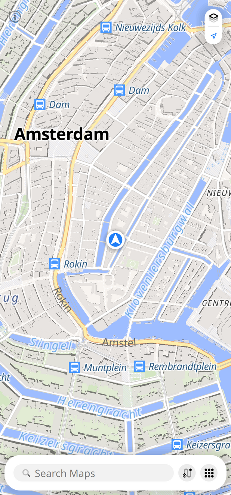
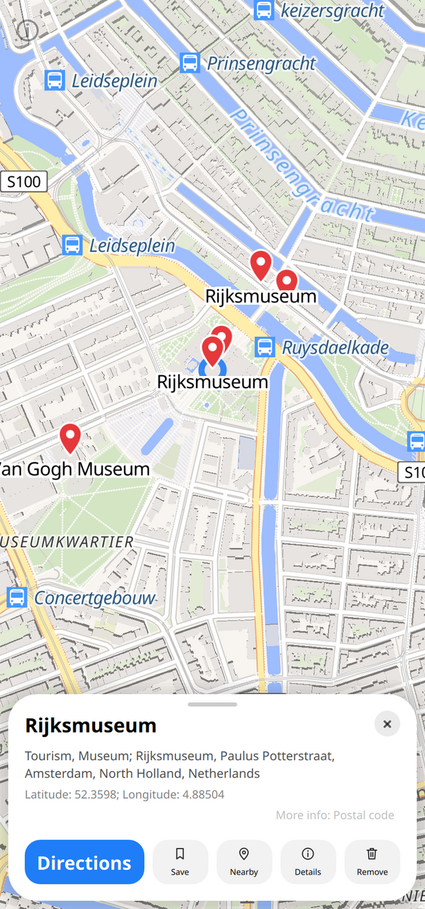
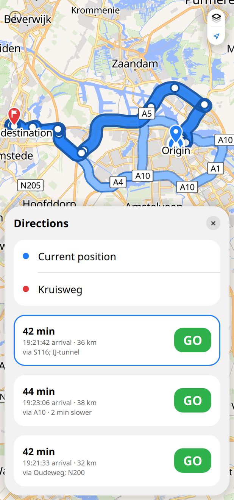
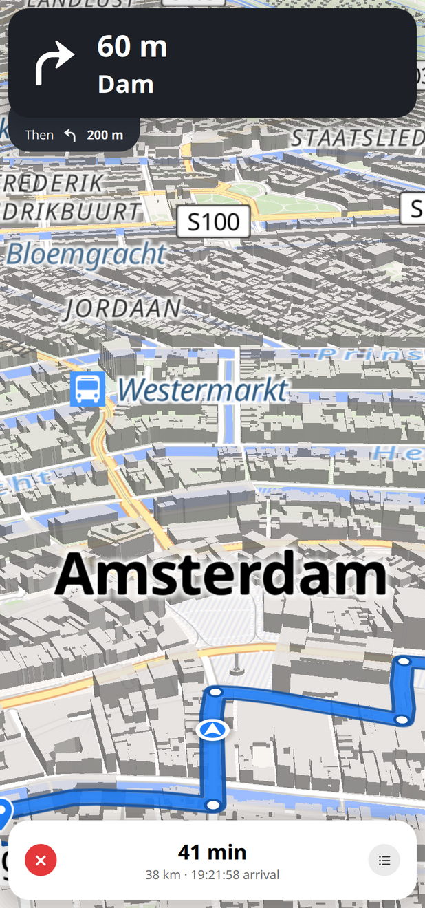
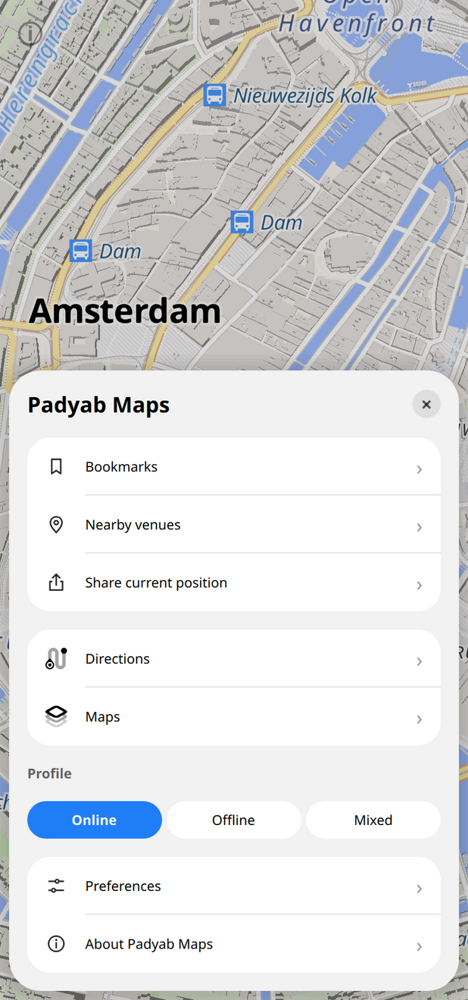

# Padyab Maps

Padyab Maps shows maps, finds places and routes, and gives turn by
turn navigation. It runs on Linux phones and desktops (Ubuntu Touch,
Kirigami, Qt Quick Controls; Qt 5 and Qt 6), with an interface of
floating cards and sheets over the map.

<p>





</p>

## Based on Pure Maps

Padyab Maps is a fork of [Pure Maps](https://github.com/rinigus/pure-maps)
by Rinigus, which itself continues
[WhoGo Maps](https://github.com/otsaloma/whogo-maps) by Osmo Salomaa.
The map engine, routing, search, offline support through OSM Scout
Server, voice navigation and the platform support all come from Pure
Maps. Padyab Maps changes the interface and some defaults:

- Search, place cards, route selection, navigation, the map chooser
  and the menu are cards and sheets over the map.
- Alternative routes are offered before starting navigation, with
  their time, distance and main street.
- Online routing uses the public [Valhalla](https://github.com/valhalla/valhalla)
  server of [FOSSGIS](https://www.fossgis.de), so no API key is needed.
  Please keep to its fair use terms: at most one request per second
  and no heavy use.
- New map markers, position marker and app icon.

Fixes that also matter for Pure Maps are meant to go upstream as
separate pull requests.

Padyab Maps is free software released under the GNU General Public
License (GPL), version 3 or later, see [`COPYING`](COPYING). The
copyright of the original code stays with its authors.

## Install

Ubuntu Touch click packages are built by the
[Click package workflow](.github/workflows/click.yml) and attached to
[releases](https://github.com/logicalangel/pure-maps/releases). The app
id is `padyab-maps.logicalangel`, so it can be installed next to Pure
Maps. For other platforms, build from source as described below.

## Feedback

Please use the [issues](https://github.com/logicalangel/pure-maps/issues)
of this repository. Problems that also happen in Pure Maps are best
reported [there](https://github.com/rinigus/pure-maps/issues).


## Command line options

Padyab Maps supports positional argument (one) that could either specify
`geo:latitude,longitude` URI or a search string that will be searched
by geocoder.

If Padyab Maps instance is running already, it will be contacted via
DBus and the request will be forwarded.


## DBus API

DBus (service `io.github.logicalangel.PadyabMaps` at session bus) can be used
to

* search: method `Search`
* show poi: method `ShowPoi`
* get navigation status and control it.

There service is split as described below.

### Global actions

Path: `/io/github/logicalangel/PadyabMaps`
Interface: `io.github.logicalangel.PadyabMaps`

Methods:

* `Search(String search_string)` - activates search action for given
  `search_string`

* `ShowPoi(String title, Double latitude, Double longitude)` - show
  POI on map with the given coordinates and title.


### Navigation

Path: `/io/github/logicalangel/PadyabMaps/navigator`
Interface: `io.github.logicalangel.PadyabMaps.navigator`

Methods:

* `Clear()` - stops navigation and removes current route

* `Start() -> Boolean` - start navigation and returns `true` if
  successful. If already started or has no route defined, will return
  `false` to indicate failure.

* `Stop()` - stop navigation if running.

Properties and signals:

Each property has a corresponding `...Changed` signal to indicate when
the value of the property has changed.

* `destDist`, `destEta`, `destTime` - human readable strings with the
  remaining distance, time, and estimated time of arrival

* `direction` and `directionValid` - bearing of the current route
  segment and whether it is valid (current location is on route)

* `hasRoute` - whether route has been set in application

* `icon` - icon name for the next maneuver

* `language` - navigation instructions language

* `manDist`, `manTime` - remaining distance and time for the next
  maneuver in human readable form

* `mode` - mode of transportation

* `narrative` - longer next maneuver instruction, should be available
  for all maneuvers

* `alongRoute` - whether current location is on route and movement is
  along it.

* `progress` - current progress along the route in percentage (0-100)

* `running` - whether navigation in active

* `street` - short form of the narrative usually shown in Padyab Maps
  next to the maneuver icon. Could be absent for some maneuvers

* `totalDist`, `totalTime` - total route distance and time in human
  readable form.


## API keys

Note that you will need API keys if you wish to access the services
that require them (such as Mapbox). For that, register as a developer
and insert these keys in the preferences. Among services that don't
require API keys are OSM Scout Server (for offline maps), OpenFreeMap
(map tiles), Photon (search) and the FOSSGIS Valhalla server
(routing).


## Packaging

Pure Maps is packaged for different distributions. Included in the
source tree: Sailfish OS version is packaged as RPM, Linux version is
packaged using Flatpak or RPM, and Ubuntu Touch version as
click. Several distributions provide packaging scripts in their source
trees.

For packaging, please copy `poor/apikeys.py` to `tools/apikeys.py` and
fill missing API keys for the services that you plan to use. Note that
the format of `tools/apikeys.py` has changed with 2.9 release.

Flatpak specific instructions are available under `packaging/flatpak`.

Ubuntu Touch specific instructions are available in
[Ubuntu Touch README](packaging/click/README.md).


## Development

## Development environment

For development of Padyab Maps and testing on desktop, you would have to
choose platform for which you develop, install dependencies, and be
able to run the application. In this case, Qt Creator or VSCode can be used.

Alternative is to use Dev Containers. Three containers are available:

* `Qt5 Latest (Debian 12)` provides the latest Qt 5 packages available in
  Debian 12, currently Qt 5.15.8.
* `Qt6 Latest (Fedora 44)` tracks the latest Qt 6 packages released by
  Fedora 44.

To use them, install a Dev Containers compatible editor extension, such as
VSCode Dev Containers, and make sure either Docker or Podman is available.
Open the Padyab Maps source tree in the editor, run the "Dev Containers: Reopen
in Container" command, and select one of the containers above. The container
builds the development dependencies and mounts the source tree at `/workspace`.
If you switch containers later, use the "Dev Containers: Rebuild and Reopen in
Container" command so the selected image is rebuilt.
See [Dev Container README](.devcontainer/README.md) for details about containers.

There are three CMake presets available: `debug-kirigami-qt5` for Qt 5,
`debug-qtcontrols6` for Qt 6, and `debug-kirigami6` for Qt 6 with Kirigami.
These presets use Ninja, write the build tree to `build`, set
`CMAKE_INSTALL_PREFIX` to `install` under the source tree, enable
`RUN_FROM_SOURCE`, and bundle the development copies of GPXPy and the Geoclue2
Qt plugin. Configure with
`cmake --preset <preset-name>` and build with `cmake --build build`.

Do not run `cmake --install` for builds configured with these presets. They are
made for running Padyab Maps directly from the source folder, and CMake emits a
warning for this configuration. For installation or packaging, use a separate
build configured without `RUN_FROM_SOURCE`.

Another alternative, is to use Flatpak-based environment and develop using
that. For this approach, see separate
[README](packaging/flatpak/README.md).

Building and Debugging for Ubuntu Touch is described in
[README](packaging/click/README.md).


## Platforms

To support multiple platforms, QML code is split into
platform-specific and platform-independent parts. Platform-independent
part is in `qml` folder with the platform-dependent code under
`qml/<platform-id>`. Correct platform is picked up in installation
phase (`make install`) or is set by `make` for local builds.

Within platform-independent code, platform is included allowing to
access platform-specific implementations of page stack, file dialog,
and other specific aspects. For this approach to work, API in the
platform specific implementation has to be the same for all platforms.

To add new platform, add new directory under `qml`, new Makefile
target to set it, and implement all the required QML items. Take a
look under other platforms for examples.

## Building from Source

To build Padyab Maps from source, please refer to the [Build.md](./Build.md) file.
It provides comprehensive instructions for compiling the application on systems such as Debian 12 and Ubuntu 24.04.

### General

Throughout QML, Python, and C++ code, all the same type items
(properties, signals, functions), are ordered alphabetically.

Its possible that some of the implemented code does not fully comply
with the outlined order. Then it should be fixed eventually.


### QML

To simplify development, there are few simple rules regarding QML file
organization. QML files are organized as follows (use the needed
components):

```
import A
import B
import pm 1.0

import "js/util.js" as Util

Item {
    id: item

    // base class defined properties in alphabetic order
    prop_a: val_a
    prop_b: val_b

    // new properties in alphabetic order
    property         var  np_a: default_a
    default property bool np_b: default_b

    // readonly properties
    readonly property var images: QtObject {
        readonly property string pixel:         "pure-image-pixel"
        readonly property string poi:           "pure-image-poi"
        readonly property string poiBookmarked: "pure-image-poi-bookmarked"
    }

    // signals
    signal mySignal

    // local unexported properties
    property bool _locked: false

    // behavior
    Behavior on bearing {
        RotationAnimation {
            direction: RotationAnimation.Shortest
            duration: map.ready ? 500 : 0
            easing.type: Easing.Linear
        }
    }

    // new sub-items following the same principles
    Item {
        id: subitem
    }

    // connections
    Connections {
    }

    // signal handlers
    Component.onCompleted: init()
    onActivated: doSomething()

    // signal handlers as functions
    function handleActivated(activated_arg) {
      doSomethingWithArg(activated_arg)
    }

    // functions
    function a() {
        return 10;
    }
}
```
## Translations

You can translate Pure Maps to a new language or improve an existing 
translation using [Transifex](https://explore.transifex.com/rinigus/pure-maps/).

If you don't have a Transifex account and want to fix a minor issue, you can 
create a [pull request](https://github.com/rinigus/pure-maps/pulls) or [open an issue](https://github.com/rinigus/pure-maps/issues/).
